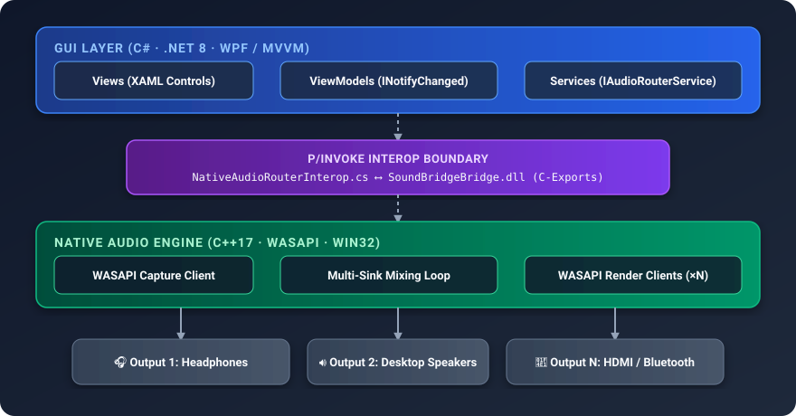
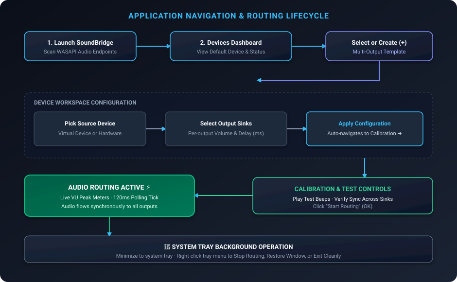

# SoundBridge — Developer Guide

> **Target audience:** Contributors, integrators, and developers working on or building SoundBridge internals.  
> For the end-user download and feature guide, see the [Root README](../README.md).

---

## Architecture Overview

SoundBridge is a modular two-layer desktop application separating the WPF user presentation from the real-time WASAPI audio routing engine.

<p align="center">
  
</p>

<details>
<summary>Click to view text architecture diagram</summary>

```text
┌────────────────────────────────────────────────────────────────────────┐
│                   GUI LAYER (C# · .NET 8 · WPF / MVVM)                 │
│   Views (XAML Controls) ⟷ ViewModels ⟷ Services (IAudioRouterService) │
│   Assembly: SoundBridge.exe                                            │
└──────────────────────────────────┬─────────────────────────────────────┘
                                   │ P/Invoke calls
┌──────────────────────────────────▼─────────────────────────────────────┐
│                       P/INVOKE INTEROP BOUNDARY                        │
│   NativeAudioRouterInterop.cs ⟷ SoundBridgeBridge.dll (C Exports)      │
└──────────────────────────────────┬─────────────────────────────────────┘
                                   │ C-linkage APIs
┌──────────────────────────────────▼─────────────────────────────────────┐
│                 NATIVE AUDIO ENGINE (C++17 · WASAPI · WIN32)           │
│   WASAPI Capture Client ➔ Multi-Sink Mixing Loop ➔ Render Clients (×N) │
└──────────────────────────────────┬─────────────────────────────────────┘
                                   │ Synchronized audio frames
         ┌─────────────────────────┼─────────────────────────┐
         ▼                         ▼                         ▼
  🎧 Headphones             🔊 Desk Speakers          📡 HDMI / Bluetooth
```

</details>

The GUI communicates with the native backend exclusively through [`NativeAudioRouterInterop.cs`](app/Services/NativeAudioRouterInterop.cs) via P/Invoke into `SoundBridgeBridge.dll`. No COM activation or WinRT is used in the routing path.

---

## Application State & Navigation Flow

This flowchart illustrates the navigation lifecycle and state transitions across ViewModels (`MainViewModel`, `DevicesViewModel`, `DeviceWorkspaceViewModel`, `CalibrationViewModel`):

<p align="center">
  
</p>

<details>
<summary>Click to view text lifecycle breakdown</summary>

```text
[Launch SoundBridge]
         │
         ▼
[1. Devices Dashboard] ──────────► [2. Device Workspace]
 (WASAPI Device Scan,                (Pick Master Source,
  Windows Default Output)             Select Output Sinks,
                                      Set Volume & Delay ms)
                                             │
                                             ▼
                                  [Apply Configuration]
                                     (Auto-navigates)
                                             │
                                             ▼
[4. Active Audio Routing] ◄─────── [3. Calibration Page]
 (120ms Polling Tick,                 (Play Test Beeps,
  Live Peak Level Meter,               Start / Disable Routing,
  Multi-Sink Fan-Out)                  Update Routing Live)
         │
         ▼
[5. System Tray Mode]
 (Background Operation,
  Restore / Stop / Exit)
```

</details>

---

## Repository Layout

```
/                               ← Repository root
├── .github/
│   └── workflows/
│       ├── build.yml           ← CI: build verification on push/PR to main
│       └── release.yml         ← CD: WiX MSI build & GitHub Release on vX.Y.Z tag
├── SoundBridge/
│   ├── app/                    ← C# WPF GUI (SoundBridge.Gui.csproj)
│   │   ├── Models/             ← Pure data models (AudioDeviceDescriptor, AppSettings, ...)
│   │   ├── Services/           ← Business logic, COM interop & P/Invoke
│   │   ├── ViewModels/         ← MVVM ViewModels (INotifyPropertyChanged)
│   │   ├── Views/              ← XAML pages & Controls
│   │   └── assets/             ← icon.ico, icon.png, beep.wav
│   ├── backend/                ← C++17 native audio engine (CMake)
│   │   ├── src/
│   │   │   ├── audio/          ← WASAPI capture & render abstractions
│   │   │   ├── engine/         ← Multi-sink routing & mixing loop
│   │   │   ├── bridge/         ← Flat C-linkage exports for P/Invoke
│   │   │   └── util/           ← COM helpers, GUIDs & logging
│   │   └── CMakeLists.txt
│   ├── installer/              ← WiX v4 MSI packaging
│   │   ├── Package.wxs         ← WiX component declarations
│   │   ├── build-msi.ps1       ← Packaging script with auto ProductCode generation
│   │   ├── build-msi.bat       ← Entrypoint wrapper
│   │   └── PrivacyAgreement.rtf
│   ├── docs/                   ← Visual documentation & architectural specs
│   ├── soundbridge-site/       ← Product landing website
| Metadata | `app.meta.json` — drives versioning and GUIDs 
|   |
│   └── CHANGELOG.md
├── README.md                   ← End-user landing page
└── .gitignore
```

---

## Tech Stack

| Layer | Technology |
| --- | --- |
| GUI Framework | WPF / .NET 8 (`net8.0-windows`) |
| Architectural Pattern | MVVM (`INotifyPropertyChanged`, `RelayCommand`) |
| Audio Engine | WASAPI (Windows Audio Session API) in Win32 C++ |
| Native Interop | P/Invoke via `SoundBridgeBridge.dll` (C-linkage exports) |
| Native Build | CMake 3.20+, C++17, MSVC x64 |
| Installer | WiX Toolset v4 (MSI, per-machine) |
| CI/CD | GitHub Actions (`windows-latest` runners) |
| Versioning | `app.meta.json` — drives versioning and GUIDs |

---

## Prerequisites

| Tool | Version | Required For |
| --- | --- | --- |
| Visual Studio 2022 | 17.8+ | C++ MSVC v143 toolset (`Desktop development with C++`) |
| .NET 8 SDK | 8.x | WPF application build & publish |
| CMake | 3.20+ | Native backend configure and build |
| WiX Toolset CLI | v4+ | MSI packaging (`dotnet tool install --global wix`) |

---

## Building Locally

### 1. Clone the Repository

```powershell
git clone https://github.com/prateek271/SoundBridge.git
cd SoundBridge/SoundBridge
```

### 2. Build Native Audio Engine

```powershell
cmake -S backend -B backend/build-integration -A x64
cmake --build backend/build-integration --config Release
# Generates: backend/build-integration/Release/SoundBridgeBridge.dll
```

### 3. Build & Run the WPF GUI

```powershell
# Debug build for local development
dotnet build app/SoundBridge.Gui.csproj -c Debug

# Run the app
dotnet run --project app/SoundBridge.Gui.csproj
```

*(The `.csproj` automatically copies `SoundBridgeBridge.dll` into the output directory upon build).*

### 4. Build the MSI Installer

```powershell
.\installer\build-msi.bat
# Generates: dist/installer/SoundBridgeSetup-v<version>.msi
```

---

## Key Source Files

### GUI Layer (`app/`)

| File | Purpose |
| --- | --- |
| [`NativeAudioRouterService.cs`](app/Services/NativeAudioRouterService.cs) | Production audio service executing P/Invoke into `SoundBridgeBridge.dll` |
| [`MockAudioRouterService.cs`](app/Services/MockAudioRouterService.cs) | Standalone dummy router used for fast UI testing without audio hardware |
| [`SystemDefaultAudioEndpointService.cs`](app/Services/SystemDefaultAudioEndpointService.cs) | Direct COM interop (`IMMDeviceEnumerator`) detecting active Windows playback device |
| [`JsonTemplateStore.cs`](app/Services/JsonTemplateStore.cs) | Persists user device routing profiles to `%LocalAppData%\SoundBridge\templates.json` |
| [`JsonAppSettingsStore.cs`](app/Services/JsonAppSettingsStore.cs) | Persists user configurations to `%LocalAppData%\SoundBridge\settings.json` |
| [`DevicesViewModel.cs`](app/ViewModels/DevicesViewModel.cs) | Overview dashboard with live VU level monitoring and 120ms polling loop |
| [`DeviceWorkspaceViewModel.cs`](app/ViewModels/DeviceWorkspaceViewModel.cs) | Routing matrix editor for selecting inputs/outputs and latency offsets |
| [`CalibrationViewModel.cs`](app/ViewModels/CalibrationViewModel.cs) | Routing activation control and calibration test tone generator |

### Native Audio Backend (`backend/src/`)

| Directory | Purpose |
| --- | --- |
| [`audio/`](backend/src/audio/) | WASAPI `IMMDevice`, `IAudioClient`, and `IAudioRenderClient` wrappers |
| [`engine/`](backend/src/engine/) | Low-latency audio loop fanning out capture audio to multiple render clients |
| [`bridge/`](backend/src/bridge/) | Flat C exports (`StartRouting`, `StopRouting`, `EnumerateDevices`, `GetPeakLevel`) |
| [`util/`](backend/src/util/) | COM memory lifecycle management, HRESULT checking, and thread synchronization |

---

## Release & Versioning Strategy

Releases adhere to [Semantic Versioning](https://semver.org/) (`vMAJOR.MINOR.PATCH`).

```json
{
  "product": { "version": "1.5.0" },
  "installer": {
    "upgradeCode": "XXXXXXXX-XXXX-XXXX-XXXX-XXXXXXXX8DD6",
    "productCodes": { "1.5.0": "XXXXXXXX-XXXX-XXXX-XXXX-XXXXXXXX7EEE" }
  }
}
```

To create a new release:

1. Update version in `app.meta.json`.
2. Commit and push changes to `feature-{feature_name}`.
3. Tag the release commit and push:

  ```powershell
   git tag vX.X.X
   git push origin vX.X.X
  ```

1. GitHub Actions [`release.yml`](../.github/workflows/release.yml) triggers automatically on the tag push, builds the MSI installer in a clean environment, and publishes the release on GitHub.

---

## License

PolyForm Strict License 1.0.0 — see [LICENSE](../LICENSE) for details.
