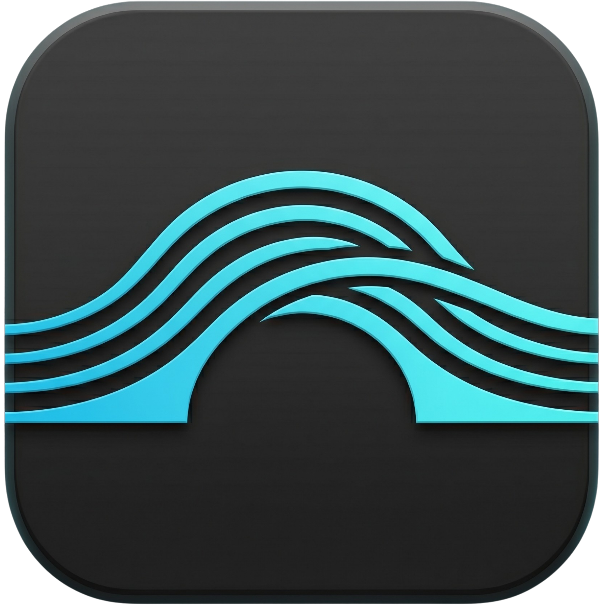

<h1 align="center">
  <br/>
  SoundBridge
</h1>

<p align="center">
  <strong>Send your audio everywhere — simultaneously.</strong><br/>
  One source. Every speaker, headphone, and monitor at once.<br/>
  No subscriptions. No bloat. Just audio, routed your way.
</p>

<p align="center">
  <a href="../../releases/latest">
    
  </a>
</p>

<p align="center">
  
  
  
</p>

---

## What is SoundBridge?

SoundBridge is a **Windows audio routing app** that lets you play audio through **multiple output devices at the same time** — speakers, headphones, HDMI, Bluetooth — all from a single source, perfectly in sync.

Whether you're a content creator monitoring your stream on headphones while speakers fill the room, a home studio engineer running multiple monitor pairs, or just someone who wants audio everywhere — SoundBridge handles it.

---

## Download & Install

> **Requirements:** Windows 10 (build 1809) or later · 64-bit

1. 👉 **[Download the latest MSI from Releases](../../releases/latest)**
2. Run `SoundBridgeSetup-v1.5.0.msi`
3. Accept the privacy agreement, pick your shortcut preference, and click Install
4. Launch **SoundBridge** from the Start Menu — you're ready

---

## How to Use

```
1. Open SoundBridge — the Devices page greets you
2. Click  +  in the sidebar to create a new Multi-Output Device template
3. Name your template (e.g. "Headphones + Speakers")
4. Pick a source device and tick the outputs you want audio sent to
5. Set volume and delay per output if needed
6. Click  Apply Configuration → Select  — Calibration page opens automatically
7. Press  Start Routing  — audio now flows to all selected outputs
8. Use  Play Test Beeps  to verify sync and fine-tune delays
9. Minimize to tray — routing continues silently in the background
```

---

## Features

### 🔊 Multi-Output Routing

Route audio to as many physical devices as you want simultaneously — with no quality loss. Your headphones, desk speakers, and HDMI display can all play at once.

### 🎛️ Per-Output Volume

Each output gets its own independent volume level, saved in your template.

### ⏱️ Delay Compensation

Add millisecond delay per output to keep physically distant speakers in perfect sync.

### 📋 Named Templates

Save your routing setups as named templates. Switch between "Gaming", "Studio", and "Surround" in one click. Delete any template with the trash icon in the sidebar.

### 📡 Live Status

The Devices page shows a live flowchart of active routing, a VU meter, and a **Windows active output indicator** — you always know exactly where your audio is going.

### 🔔 System Tray

Minimize to tray and SoundBridge keeps routing in the background. Right-click the tray icon to restore, stop routing, or exit.

### 🚀 Start with Windows

Enable in Settings and SoundBridge is ready before your first app opens.

---

## Do I Need a Virtual Audio Device?

**No — SoundBridge works with any audio device as the source**, including physical ones.

However, many users pair it with a **virtual audio device** to capture application audio (browser, music player, game) and route it to multiple outputs. Two popular free options:

<details>
<summary>Optional: virtual audio drivers</summary>

| Driver | License | Use |
| --- | --- | --- |
| [MikeTheTech Virtual Audio Driver](https://github.com/MikeTheTech/VAD) | MIT | Set as output in any app; SoundBridge routes from it |
| [VB-Cable](https://vb-audio.com/Cable/) | Freeware | Same idea — classic freeware option |

Install either one, set your app (Spotify, browser, DAW…) to output to the virtual device, and choose that virtual device as the **master source** in SoundBridge.

</details>

---

## System Requirements

| | Minimum |
| --- | --- |
| OS | Windows 10 version 1809 (build 17763) or later |
| Architecture | x64 |
| Runtime | Included (self-contained install) |
| Disk | ~80 MB |

---

## Privacy

SoundBridge stores templates and settings **only on your local machine** under `%LocalAppData%\SoundBridge`. It makes no network connections, collects no telemetry, and sends nothing anywhere. See [`docs/PrivacyPolicy.md`](docs/PrivacyPolicy.md) for the full policy.

---

## Changelog

See [CHANGELOG.md](CHANGELOG.md) for what's new in each version.

---

## License

MIT — see [LICENSE](LICENSE) for details.
